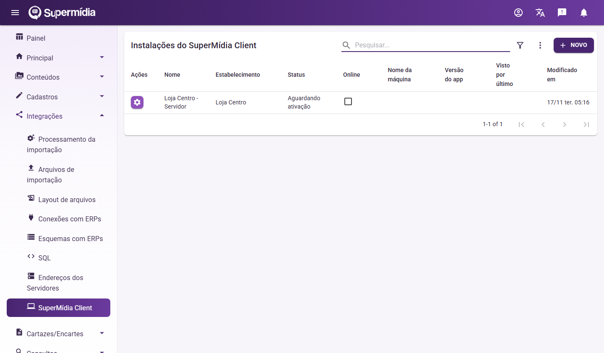
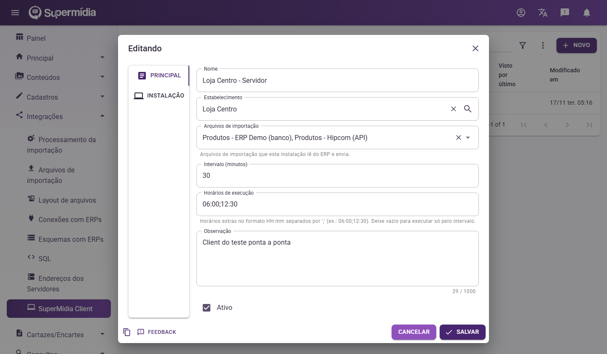
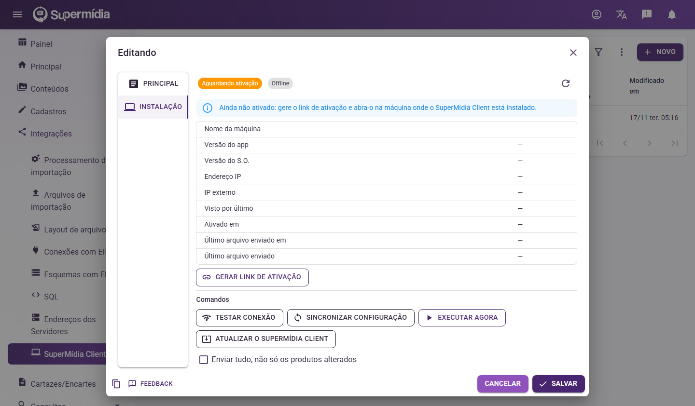
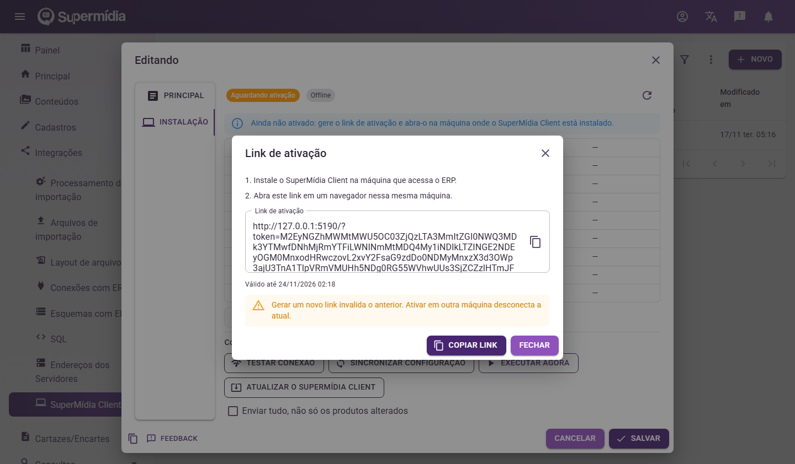
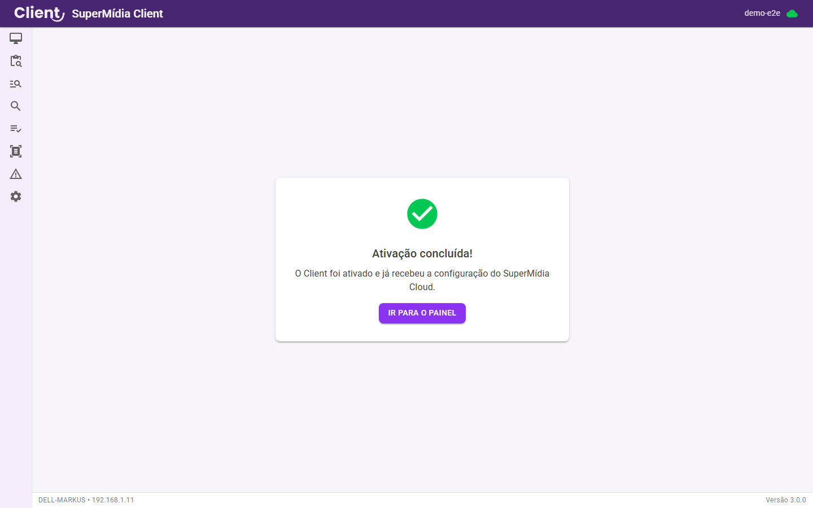
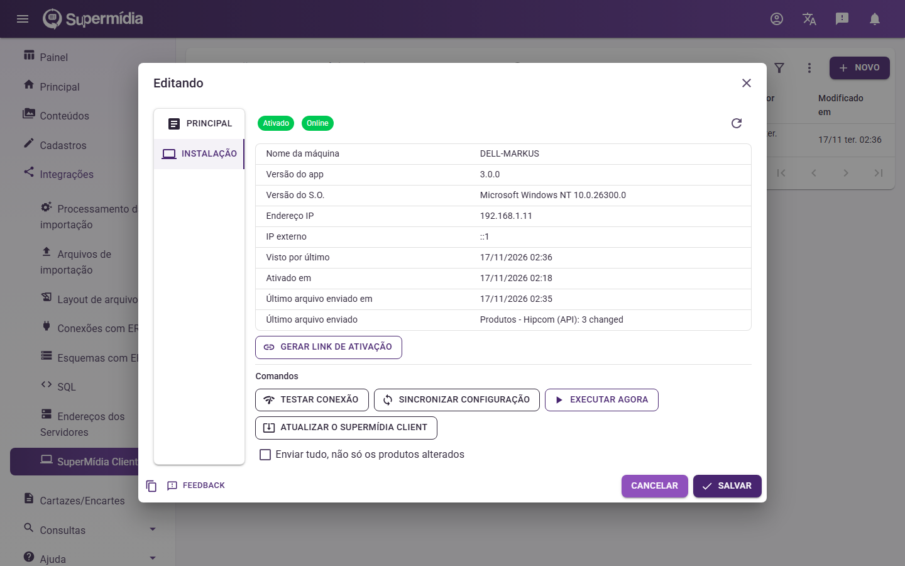
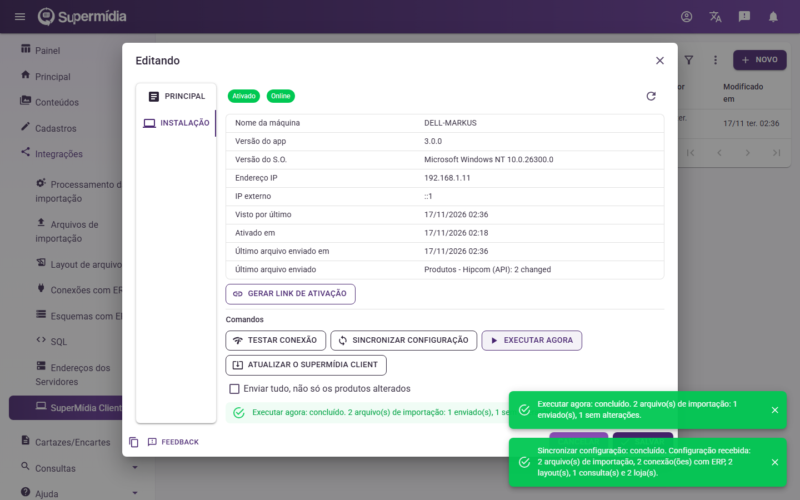
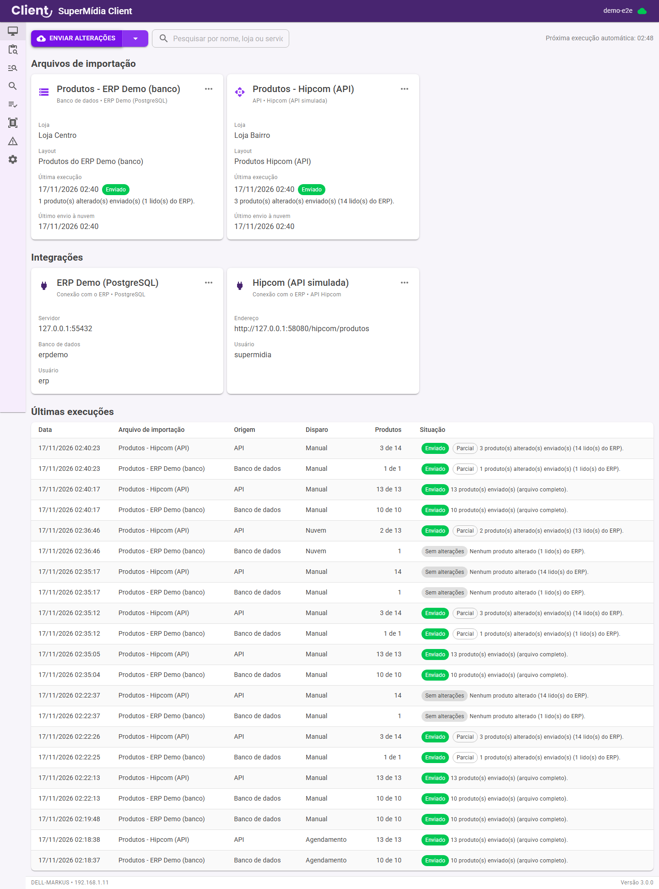

# SuperMídia Client

O **SuperMídia Client** é o programa instalado num computador da loja que tem acesso ao ERP. Ele lê os produtos do ERP e envia para o SuperMídia só o que mudou, nos horários programados.

Acesse pelo menu **Integrações → SuperMídia Client**.

A lista mostra cada instalação, a loja, a situação (*Aguardando ativação* ou *Ativado*), se está **online**, a máquina, a versão e quando foi vista pela última vez.

## Passo a passo

1. Cadastre a instalação.
2. Gere o link de ativação e abra-o no computador da loja.
3. Escolha quais arquivos de importação o Client executa.
4. Acompanhe e envie comandos pela aba **Instalação**.

## Cadastrar uma instalação

1. Clique em **Adicionar**.
2. Na aba **Principal**, preencha:
   - **Nome** e **Loja**;
   - **Arquivos de importação**: os que esta instalação lê do ERP e envia;
   - **Intervalo (minutos)** e **Horários de execução** (horários extras, por exemplo `06:00;12:30`; vazio executa só pelo intervalo);
   - **Observação** e **Ativo**.
3. Clique em **Salvar**.

> Depois de salvar, abra o registro novamente para gerar o link de ativação.

## Ativar no computador da loja

1. Instale o SuperMídia Client no computador que acessa o ERP.
2. No cadastro, abra a aba **Instalação** e clique em **Gerar link de ativação**.

   

3. Clique em **Copiar link** e abra o link num navegador **nesse mesmo computador**. O link vale por 7 dias.

   

4. O Client mostra que foi ativado, e a aba **Instalação** passa a mostrar a máquina, a versão, o IP e o último arquivo enviado.

   

   

> Gerar um novo link invalida o anterior. Ativar em outro computador desconecta o atual.

## Escolher quem executa cada arquivo de importação

Em **Arquivos de importação**, o campo **Local de sincronização** diz quem executa o arquivo:

| Local | Quem executa |
|---|---|
| **Nuvem** | o próprio SuperMídia, nos **Agendamentos (Cron)** do arquivo. Precisa da conexão com o ERP |
| **Client local** | o SuperMídia Client da loja, nos **Agendamentos (Cron)** do arquivo |

Com **Client local** não é preciso marcar o arquivo no cadastro do Client. O SuperMídia escolhe a instalação nesta ordem:

1. a instalação que já lista o arquivo no cadastro;
2. senão, a instalação da mesma loja do arquivo;
3. senão, se só existe uma instalação, ela.

Ao salvar um arquivo de importação, as instalações online recebem a configuração nova na hora.

## Comandos

Na aba **Instalação**, em **Comandos**, com a resposta do Client na própria tela:

| Comando | O que faz |
|---|---|
| **Testar conexão** | o Client responde com o nome do computador e a versão |
| **Sincronizar configuração** | o Client baixa a configuração na hora |
| **Executar agora** | executa os arquivos de importação. Marque **Enviar tudo, não só os produtos alterados** para mandar o arquivo completo |
| **Atualizar o SuperMídia Client** | procura e instala uma versão nova |

Salvar o cadastro também manda **Sincronizar configuração**, se a instalação estiver online. Com a instalação offline o comando é recusado.

## O que é enviado

O Client envia só os produtos que mudaram desde o último envio. Nesse caso nada é desativado por não ter vindo no arquivo. Com **Enviar tudo**, vai o arquivo completo.

## Perguntas frequentes

**A instalação aparece offline.** Confira se o computador está ligado, com internet e com o serviço do SuperMídia Client rodando. Use **Atualizar situação** na aba **Instalação**.

**O link de ativação não funciona.** Ele precisa ser aberto no computador onde o Client está instalado e vale por 7 dias. Gere um novo link se precisar.

**Os produtos não chegaram.** Confira se o arquivo de importação está no cadastro da instalação ou com o local **Client local**, e use **Executar agora**.

**O comando demora.** Se o Client não responder a tempo, a tela avisa, mas o comando ainda pode ser concluído.

## Veja também

- [Layout de arquivos](../Layout-Arquivos.md)
- [Produtos](../Produtos.md)
